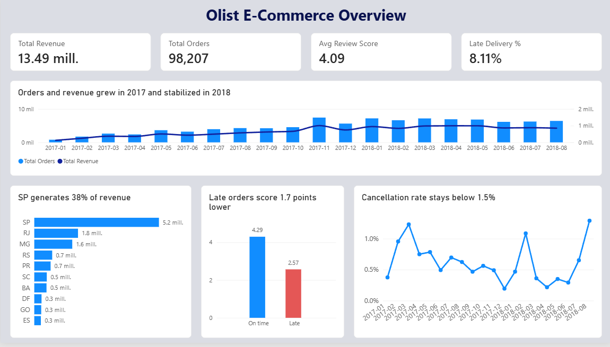
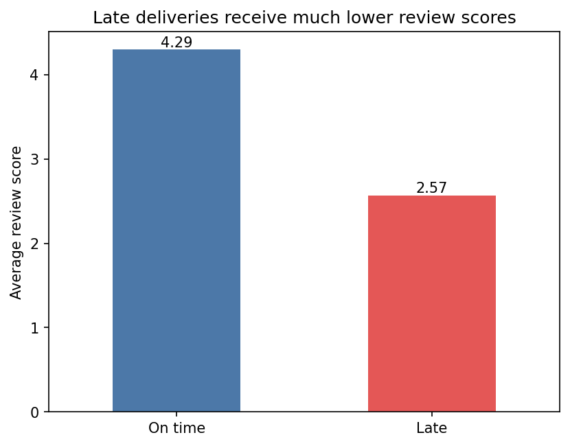
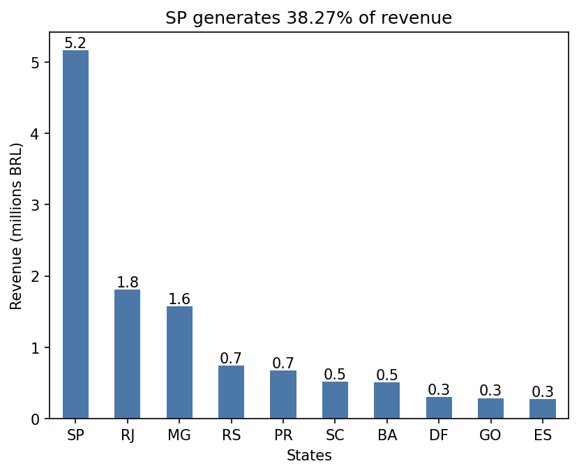
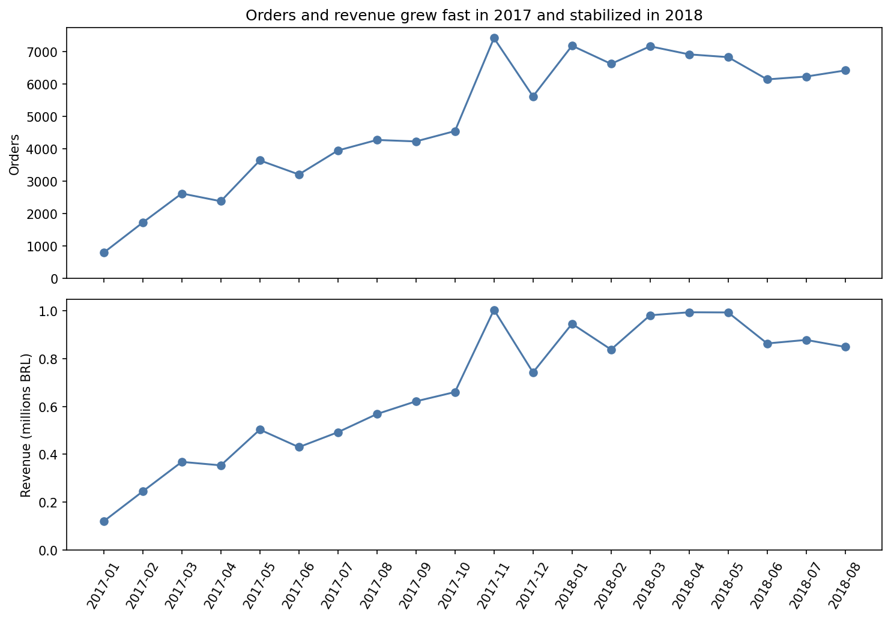

# Olist E-Commerce Analysis

End-to-end analysis of the [Olist Brazilian E-Commerce dataset](https://www.kaggle.com/datasets/olistbr/brazilian-ecommerce): data exploration, SQL analysis, data cleaning, Python analysis and a Power BI dashboard.

## Dashboard

Built in Power BI from `orders_master.csv` (one row per order), with KPIs, monthly trend, revenue by state, delivery performance and cancellation rate.

Full report: [reports/final_report.pdf](reports/figures/final_report.pdf)

## Business questions

| # | Question | Metric | Tables |
|---|---|---|---|
| 1 | Which product categories receive the best and worst review scores (minimum 100 reviews)? | Average `review_score` per category | `order_reviews`, `order_items`, `products`, `product_category_name_translation` |
| 2 | Which customer states generate the most revenue? | Sum of `price` per customer state (excluding canceled and unavailable orders) | `orders`, `customers`, `order_items` |
| 3 | How do monthly orders and revenue evolve over time? | Number of orders and sum of `price` per month | `orders`, `order_items` |
| 4 | What share of orders is canceled, and does it vary by state or month? | Canceled orders / total orders, by state and by month | `orders`, `customers` |
| 5 | Which payment methods are used most, and how many installments do customers choose? | Number of payments per `payment_type`; distribution of `payment_installments` | `order_payments` |

### Assumptions

- Revenue = sum of `price` (shipping excluded), counting only orders that are not `canceled` or `unavailable`.
- Cancellation rate uses all orders as the denominator.

## Findings

- **Q1 – Review scores by category:** scores differ little across categories, but
  `office_furniture` has the lowest average (3.62) with a large sample (1,263 orders).
  A low score can come from the product, the delivery or the seller; this dataset
  cannot separate them.
- **Q2 – Revenue by state:** revenue is highly concentrated: SP alone generates 38.27%
  and the top 3 states account for 63.4%.
- **Q3 – Monthly trend:** orders grew quickly during 2017 (peak in Nov 2017: ~7,400
  orders, 1.00M BRL) and stabilized in 2018. Growth came mainly from order
  volume; revenue per order rose only moderately (125 → 153).
- **Q4 – Cancellations:** only 0.63% of orders are canceled. Differences between
  states are small and based on few cases, and the monthly peaks do not follow demand.
- **Q5 – Payments:** credit card makes up 73.92% of payments (avg 3.51 installments,
  max 24); every other method has exactly 1 installment. 11 payments are anomalous:
  9 have a value of 0 and 2 credit card payments have 0 installments. They are marked
  in the cleaned data, not deleted; the 2 with 0 installments are excluded from the
  installment analysis.
- **Delivery vs. review score:** 8.1% of delivered orders arrived late, and they score 2.57 on average versus 4.29 for on-time orders. Delivery performance is a major driver of customer satisfaction.

## Key results

## Data cleaning summary

- Dates stored as text were converted to `datetime`.
- Missing values were kept as nulls and, when they were unexpected, marked with a flag column instead of being deleted or invented.
- Zip codes were converted to text and padded to 5 digits (the leading zero had been lost).
- 610 products without a category were labeled `unknown`; 4 products with weight 0 were set to null.
- 34 inconsistent seller city names were normalized with a correction dictionary.
- `geolocation` was left uncleaned because the five business questions do not need coordinates.

## Notebooks

| Notebook | Content |
|---|---|
| 01 `01_data_understanding.ipynb` | Data exploration and quality checks |
| 02 `02_sql_layer.ipynb` | SQL layer: the five business questions |
| 03 `03_data_cleaning.ipynb` | Cleaning of the 8 tables |
| 04 `04_analysis.ipynb` | One row per order table, charts and delivery analysis |

## Tools

Python (pandas, matplotlib), SQL (SQLite), Power BI, Google Colab.

## Data

The raw data is **not included** in this repository. It comes from the
[Olist Brazilian E-Commerce dataset](https://www.kaggle.com/datasets/olistbr/brazilian-ecommerce) on Kaggle.

## How to reproduce

1. Download the 9 CSV files from Kaggle and place them in `data/raw/`.
2. Run `notebooks/03_data_cleaning.ipynb`. It reads from `raw/` and writes the 8 clean files to `data/processed/`.
3. Run `notebooks/04_analysis.ipynb` to build the order-level table and the charts.

## Author

**Diego Enrique Cortés Durón**, Data Analyst · [LinkedIn](www.linkedin.com/in/diego-enrique-cortés-durón-216605237) · [GitHub](https://github.com/diegocortes30)
